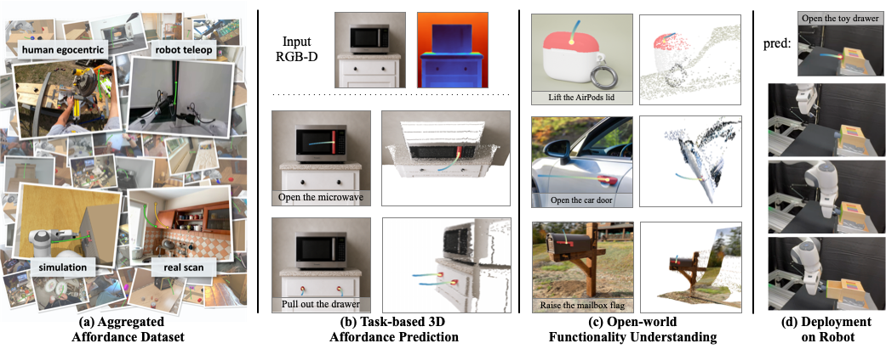

<h1 align="center">AFUN: Towards an Affordance Foundation Model for Functionality Understanding</h1>
<h3 align="center">Where + How for Functionality Understanding</h3>

<p align="center">
  Zhaoning Wang<sup>1,*</sup> &nbsp;·&nbsp; Yi Zhong<sup>1,*</sup> &nbsp;·&nbsp; Jiawei Fu<sup>2</sup> &nbsp;·&nbsp; Henrik I. Christensen<sup>2</sup> &nbsp;·&nbsp; Jun Gao<sup>1,3</sup>
</p>
<p align="center">
  <sup>1</sup>University of Michigan &nbsp;&nbsp; <sup>2</sup>UC San Diego &nbsp;&nbsp; <sup>3</sup>NVIDIA &nbsp;&nbsp;&nbsp; <sup>*</sup>Equal contribution
</p>

<p align="center">
  <a href="https://arxiv.org/abs/2606.02551"></a>
  <a href="https://www.zhaoningwang.com/AFUN/"></a>
  <a href="https://huggingface.co/AFUN-dataset"></a>
</p>
<p align="center"></p>

**TL;DR**
```
RGB + text query + depth ──► AFUN model ──► mask + 3D motion curve
```


> From a single RGB observation and a natural-language task description, **AFUN** predicts a
> **task-conditional functional mask** (*where* to interact) and a **3D post-contact motion
> curve** (*how* to interact). It pairs frozen pretrained vision-language features with
> lightweight trainable modules for joint mask + motion prediction.

Currently, this repository provides **inference-only** code: load a trained AFUN checkpoint and run it on
your own images. Depth is handled automatically — [Depth-Anything-3](https://github.com/ByteDance-Seed/Depth-Anything-3)
**generates** metric depth from a single RGB image, or [lingbot-depth](https://github.com/robbyant/lingbot-depth)
**refines** a noisy sensor (e.g. RealSense) depth map if you provide one.


<details>
<summary><b>Contents</b></summary>

- [📋 TODO](#-todo)
- [🔧 Installation](#-installation)
- [🚀 Quick Start](#-quick-start)
- [📦 Dataset & Benchmark](#-dataset--benchmark)
- [🙏 Acknowledgements](#-acknowledgements)
- [📚 Citation](#-citation)

</details>

---

## 📋 TODO

- [x] Inference code &amp; demo 
- [ ] **Training Code**
- [x] **Dataset, Evaluation, and Benchmark** — see [📦 Dataset & Benchmark](#-dataset--benchmark)
- [ ] **Robot Demonstration Code**
- [ ] **Claude Agent md Files** 

---

## 🔧 Installation

### 1. Clone (with submodules)

```bash
git clone --recursive https://github.com/EricWang12/AFUN.git
cd AFUN
# (already cloned non-recursively? run: git submodule update --init --recursive)
```

### 2. Create the environment

```bash
bash install.sh
conda activate afun
```
> NOTE: `install.sh` defaults to Python 3.11 and CUDA 13 (`cu130`). For a
> different CUDA builds, edit the file directly.


### 3. Get the checkpoint
The AFUN checkpoint `afun.pt` is hosted on **Google Drive**. Fetch it automatically  —
this also pre-caches the Hugging Face backbone weights (e.g. Qwen3-VL-8B, SAM3, Depth-Anything-3, lingbot, Sonata):
```bash
python scripts/prefetch_weights.py
```
Or download it by hand from the [Google Drive link](https://drive.google.com/file/d/1J4TNj_w3b7BTaeriBPuDJCn7q_SlV6PR/view?usp=sharing) and place it at:
```
checkpoints/afun.pt
```
The backbone weights (Qwen3-VL-8B, SAM3, Depth-Anything-3, lingbot, Sonata) download automatically
from Hugging Face on first run (cached); `prefetch_weights.py` fetches those too.

---

## 🚀 Quick Start


Run the demo with an RGB image, a text prompt, and (optionally) a sensor-depth folder:
```bash
python demo.py --rgb <path_to_rgb_image> --query <text_prompt> --depth-dir <path_to_depth_map>
```

`--depth-dir` would be a folder containing two files:
```
<depth-dir>/
├── depth.npy    # raw sensor depth — float32, millimeters, shape (H, W) matching the RGB
└── cam_K.txt    # 3×3 camera-intrinsics matrix
```
By default lingbot refines this depth; pass `--no-refine` to skip refinement and use the raw sensor depth as-is. Omit `--depth-dir`
entirely and Depth-Anything-3 estimates depth from the RGB instead.

> NOTE: Raw sensor depth without refinement generally does not work well with our model, as it is not trained on such data.

**Example 1 — sensor depth** (lingbot refines the bundled depth via `--depth-dir`):
```bash
python demo.py --rgb       examples/robot_toaster_oven/rgb.png \
               --query     "Open the toaster oven door" \
               --depth-dir examples/robot_toaster_oven
```

**Example 2 — Depth-Anything-3** (no `--depth-dir`; DA3 estimates depth from the RGB):
```bash
python demo.py --rgb examples/kitchen_fridge/rgb.png --query "Open the refrigerator door"
```


**Output** (per run, under `outputs/`):

| File | Contents |
|---|---|
| `pred_seg.png` | RGB + predicted affordance mask (red) + motion trajectory (yellow→blue, yellow = contact) |
| `pred.npz` | mask, motion parameters, intrinsics, confidence |
| `pred_3d.html` | interactive 3D point cloud + motion curve (omit with `--no-3d`) |
| `meta.json` / `summary.csv` / `montage.png` | run metadata (single / batch) |

---
**Run all bundled examples** (model loads once, then loops over `examples/`):
```bash
python run_examples.py            # add --no-3d to skip the interactive 3D HTML
```


## 📦 Dataset & Benchmark

All data is released on Hugging Face under the [**AFUN-dataset**](https://huggingface.co/AFUN-dataset)
organization (CC BY-NC-SA 4.0). Each data point is one folder: an RGB frame, its metric depth map,
the ground-truth affordance mask, the ground-truth 3D motion curve, and a language instruction.

| Dataset | What it is | Size |
|---|---|---:|
| [**AFUN**](https://huggingface.co/datasets/AFUN-dataset/AFUN) | Training set — **44,749** data points from SceneFun3D, RoboMIND, DROID, AgiBot World, RH20T, CALVIN, RLBench and VITRA human videos | 231 GiB |
| [**AFUN_eval**](https://huggingface.co/datasets/AFUN-dataset/AFUN_eval) | The three evaluation sets of Table 3 — `afun_test` (121), `scenefun3d_test` (721), `robomind2_test` (156) — with the ADE / FDE / CIM protocol described in its README | 9.9 GiB |
| [**AFUN_pool**](https://huggingface.co/datasets/AFUN-dataset/AFUN_pool) | The full **183,657**-point pool (Table 7) that AFUN was curated from. Its 106,225 Ego4D-derived points ship as annotations only, with a script that rebuilds the frames from your own Ego4D download | 363 GiB |

```bash
pip install -U huggingface_hub
hf download AFUN-dataset/AFUN_eval --repo-type dataset --local-dir afun_eval    # 9.9 GiB — start here
hf download AFUN-dataset/AFUN      --repo-type dataset --local-dir afun_train   # 231 GiB
```

Each dataset's README documents the folder layout, the `trajectory.json` schema, and a loading snippet.

---

## 🙏 Acknowledgements

This project builds on [Qwen3-VL](https://github.com/QwenLM/Qwen3-VL),
[SAM3](https://github.com/EricWang12/sam3),
[Depth-Anything-3](https://github.com/ByteDance-Seed/Depth-Anything-3),
[lingbot-depth](https://github.com/robbyant/lingbot-depth), and
[Sonata](https://github.com/facebookresearch/sonata). We thank the authors for releasing their
code and models.

---

## 📚 Citation

```bibtex
@article{wang2026afun,
  title   = {{AFUN}: Towards an Affordance Foundation Model for Functionality Understanding},
  author  = {Wang, Zhaoning and Zhong, Yi and Fu, Jiawei and Christensen, Henrik I. and Gao, Jun},
  journal = {arXiv preprint arXiv:2606.02551},
  year    = {2026},
}
```
